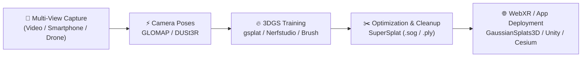

# 🌌 Awesome 3D Gaussian Splatting & Spatial Computing

**A curated index of top SaaS platforms and open-source GitHub projects for 3D Gaussian Splatting (3DGS), real-time radiance fields, WebGPU/WebGL spatial viewers, and neural 3D reconstruction.**

*Explore real-time spatial computing, 6DoF novel view synthesis, point-based radiance fields, 4D spatiotemporal splats, and XR runtime pipelines.*

---

## 📑 Table of Contents

- [🌐 Sector Overview & Market Dynamics](#-sector-overview--market-dynamics)
- [☁️ SaaS & Hosted Platforms](#️-saas--hosted-platforms)
- [⚡ Open-Source GitHub Projects](#-open-source-github-projects)
- [🛠️ Recommended End-to-End Pipelines](#️-recommended-end-to-end-pipelines)
- [🤝 How to Contribute](#-how-to-contribute)
- [💖 Support](#-support)
- [📈 Star History](#-star-history)
- [📜 Disclaimer](#-disclaimer)

---

## 🌐 Sector Overview & Market Dynamics

The global **3D Gaussian Splatting (3DGS) and spatial computing software sector** is estimated at **$1.8 billion to $2.8 billion in 2026** and is accelerating at a compound annual growth rate (**CAGR) between 16% and 21%**, projected to eclipse **$9.5 billion by 2033** across VFX, digital twins, robotics simulation, and geospatial intelligence. The industry is currently **moderately fragmented** at the application and capture-tool layer with rapid startup specialization, but exhibits **concentrated winner-take-most dynamics** around underlying GPU compute hardware (NVIDIA), foundation 3D spatial AI engines, and emerging format standards led by the Khronos Group (`KHR_gaussian_splatting`) and OpenUSD.

---

## ☁️ SaaS & Hosted Platforms

The following SaaS and hosted commercial platforms provide cloud training, on-device mobile capture, spatial scene hosting, and interactive web/XR embeds for 3D Gaussian Splatting. Products are ordered by company size (valuation / funding / revenue descending).

| Product / Platform | Company Scale &amp; Valuation 🏢 | Pricing (Starting Tier) 💳 | Free Tier &amp; Trial Limits 🎁 | Description &amp; Spatial Features 🚀 |
| :--- | :--- | :--- | :--- | :--- |
| **[Niantic Scaniverse](https://scaniverse.com)** | **$3.5B+ Valuation** ($1B+ historical gaming rev; spun out to Niantic Spatial) | **$20/month** (Plus plan, or $1 per 1,800 pay-as-you-go credits) | **Free forever**: Unlimited on-device splat capture/processing &amp; mesh export; includes 20,000 monthly cloud processing credits | On-device mobile 3DGS capture, splat editing, and geospatial Gaussian mapping across iOS and Android without mandatory cloud dependencies. |
| **[Luma AI](https://lumalabs.ai)** | **$4.0B Valuation** ($900M+ Series C round) | **$30/month** (Plus plan, $25/mo billed annually) | **Free forever**: Limited to ~80 daily credits (approx. 1 generation/capture per day), non-commercial use, watermarked exports | Multimodal generative 3D &amp; video platform (Dream Machine, Genie) with cloud 3D Gaussian Splatting pipelines and interactive WebGL scene embeds. |
| **[Polycam](https://poly.cam)** | **$150M–$250M Est. Valuation** ($22M funding, ~$6.3M ARR) | **$30/month** ($150/year, billed as $12.50/mo) | **Free forever**: Limited photo/LiDAR captures, capped exports (GLTF web export only), public scene sharing only | Cross-platform mobile and web reality-capture suite supporting cloud 3D Gaussian Splatting, LiDAR scanning, and browser scene sharing. |
| **[Spline](https://spline.design)** | **$80M–$100M Est. Valuation** ($32M funding, ~$4.7M ARR) | **$15/month** (Hobby plan, $12/mo billed annually) | **Free forever**: Limited personal files, unlimited viewers, access to basic library/templates, web exports include visible Spline watermark | Browser-first 3D design studio featuring native 3DGS import, real-time physics, collaborative scene graphs, and embeddable web showrooms. |
| **[Gracia AI](https://gracia.ai)** | **$15M–$25M Est. Valuation** ($2.9M Seed funding) | **$800/minute** of processed content (VR/Streaming tier; $2,500/min VFX tier) | **Free forever**: Free client-side VR viewer apps (Meta Quest, Apple Vision Pro) with 25+ preloaded captures and custom `.ply` local playback | Specialized volumetric 4D Gaussian Splatting (4DGS) engine delivering 6DoF photorealistic video streaming across VR headsets and desktop browsers. |
| **[KIRI Engine](https://kiriengine.app)** | **~$15M–$25M Est. Scale** (Series A hundreds of millions RMB, Huawei Hubble backed) | **$17.99/month** ($79.99/year, billed as $6.66/mo; 7-day free trial on annual plan) | **Free forever**: Max 150 photos / 2 GB per photogrammetry scan, unlimited basic exports (OBJ, FBX, STL, GLB, USDZ); 3DGS requires Pro | Cloud 3D scanning suite featuring mobile capture, 3D Gaussian Splatting, splat-to-mesh retopology, AI PBR maps, and official Blender integration. |
| **[Jawset Postshot](https://www.jawset.com/)** | **Bootstrapped / Indie VFX Leader** (Jawset TurbulenceFD creator) | **€26/month** (Indie plan, or €204/year billed as €17/mo excl. VAT) | **Free forever**: Unlimited photos/video length, SDR 8-bit color, capped at 4K resolution, non-commercial only, watermarked, PLY/SPZ export locked | High-performance desktop 3DGS workstation featuring live training previews, ACES color management, and native Unreal Engine / After Effects plugins. |
| **[Arrival.Space](https://arrival.space)** | **Early-Stage Spatial Startup** (&lt;$5M Seed stage) | **$6.99/month** (Creator plan incl. VAT) | **Free forever**: 3 GB cloud storage, standard community traffic limits, public/private immersive spaces | Cloud spatial computing showroom platform for hosting, decorating, and walking through interactive 3D Gaussian Splatting web worlds. |
| **[StorySplat](https://storysplat.com)** | **Early-Stage Splat Studio** (&lt;$5M Seed stage) | **$19/month** (Plus plan; add-on credits at $10 per 1,000 credits) | **Free forever**: 1 GB storage, non-commercial personal use, public scene sharing, interactive camera tour editor | Cloud hosting and narrative builder for crafting interactive camera walkthroughs, audio hotspots, and embeddable web presentations from `.ply` files. |

---

## ⚡ Open-Source GitHub Projects

Explore the most active open-source repositories powering the 3D Gaussian Splatting ecosystem. Repositories are ranked in descending order by GitHub stargazer count.

| Project / Repository | Stars ⭐ | Primary Focus &amp; Architecture 🔧 | License 📜 |
| :--- | :--- | :--- | :--- |
| **[bilawalsidhu/gods-eye-view](https://github.com/bilawalsidhu/gods-eye-view)** |  | Browser-based spatial intelligence simulator and interactive 3D globe built on CesiumJS with live OSINT, satellite, and flight telemetry feeds. | `MIT` |
| **[graphdeco-inria/gaussian-splatting](https://github.com/graphdeco-inria/gaussian-splatting)** |  | Seminal SIGGRAPH 2023 reference CUDA implementation for real-time 3D radiance field training with SIBR interactive viewers. | `Inria Non-Commercial / Research` |
| **[colmap/colmap](https://github.com/colmap/colmap)** |  | Industry-standard Structure-from-Motion (SfM) and Multi-View Stereo (MVS) pipeline providing camera poses and sparse point clouds for 3DGS. | `BSD-3-Clause` |
| **[nerfstudio-project/nerfstudio](https://github.com/nerfstudio-project/nerfstudio)** |  | Modular PyTorch framework unifying 3D Gaussian Splatting (`splatfacto`), NeRFs, camera pose optimizers, and a web-based training viewer. | `Apache-2.0` |
| **[playcanvas/supersplat](https://github.com/playcanvas/supersplat)** |  | Browser-based 3D Gaussian Splatting editor for trimming floaters, scene optimization, and exporting compressed `.sog` / `.compressed.ply` files. | `MIT` |
| **[MrNeRF/awesome-3D-gaussian-splatting](https://github.com/MrNeRF/awesome-3D-gaussian-splatting)** |  | Comprehensive community-curated research paper tracker, taxonomy, and implementation bibliography for 3D Gaussian Splatting. | `CC0-1.0` |
| **[naver/dust3r](https://github.com/naver/dust3r)** |  | Pose-free neural 3D dense reconstruction engine generating aligned 3D pointmaps directly from unconstrained image pairs without prior SfM. | `CC-BY-NC-SA-4.0` |
| **[nerfstudio-project/gsplat](https://github.com/nerfstudio-project/gsplat)** |  | High-performance, memory-efficient CUDA/C++ differentiable rasterization library for 3DGS with multi-GPU scaling, 2DGS, and LiDAR support. | `Apache-2.0` |
| **[ArthurBrussee/brush](https://github.com/ArthurBrussee/brush)** |  | Universal cross-platform 3D reconstruction and 3DGS training engine written in Rust with Burn and WebGPU (runs on Mac Metal, Windows, Linux, Android). | `Apache-2.0` |
| **[hustvl/4DGaussians](https://github.com/hustvl/4DGaussians)** |  | CVPR 2024 dynamic scene reconstruction framework incorporating 4D spatiotemporal HexPlane deformation fields for real-time volumetric video. | `MIT` |
| **[MrNeRF/LichtFeld-Studio](https://github.com/MrNeRF/LichtFeld-Studio)** |  | Modular desktop workstation in C++/CUDA featuring real-time training, interactive splat brush editing, Python plugins, and MCP automation. | `GPL-3.0` |
| **[aras-p/UnityGaussianSplatting](https://github.com/aras-p/UnityGaussianSplatting)** |  | Native Unity package for importing, editing, compressing, and rendering 3D Gaussian Splats in real-time inside Unity (URP/HDRP/DX12/Metal/Vulkan). | `MIT` |
| **[hbb1/2d-gaussian-splatting](https://github.com/hbb1/2d-gaussian-splatting)** |  | SIGGRAPH 2024 geometric radiance field representation using 2D oriented planar surfels for clean surface reconstruction and mesh extraction. | `MIT` |
| **[naver/mast3r](https://github.com/naver/mast3r)** |  | Advanced 3D image matching and point tracking architecture building upon DUSt3R for pixel-accurate dense correspondence and geometry. | `CC-BY-NC-SA-4.0` |
| **[antimatter15/splat](https://github.com/antimatter15/splat)** |  | Zero-dependency, lightweight WebGL 3D Gaussian Splat viewer enabling direct drag-and-drop viewing and embedding in plain HTML/JS. | `MIT` |
| **[mkkellogg/GaussianSplats3D](https://github.com/mkkellogg/GaussianSplats3D)** |  | Highly optimized Three.js-based WebGL/WebGPU 3D Gaussian Splatting renderer supporting progressive octree streaming, LODs, and VR modes. | `MIT` |
| **[nerfstudio-project/viser](https://github.com/nerfstudio-project/viser)** |  | Web-based interactive 3D visualization and coordinate transform framework for Python, robotics, and radiance field debugging. | `Apache-2.0` |
| **[colmap/glomap](https://github.com/colmap/glomap)** |  | Fast Global Structure-from-Motion pipeline delivering orders-of-magnitude faster camera pose estimation compared to incremental SfM. | `BSD-3-Clause` |
| **[WebODM/OpenSplat](https://github.com/WebODM/OpenSplat)** |  | Dependency-light C++ 3DGS training software with native CUDA, Apple Silicon Metal, AMD ROCm, and CPU execution for drone photogrammetry. | `AGPL-3.0` |
| **[spla-tam/SplaTAM](https://github.com/spla-tam/SplaTAM)** |  | Splat, Track &amp; Map: Dense RGB-D SLAM engine using 3D Gaussians for online camera tracking and high-fidelity scene reconstruction. | `Apache-2.0` |
| **[graphdeco-inria/diff-gaussian-rasterization](https://github.com/graphdeco-inria/diff-gaussian-rasterization)** |  | Core CUDA rasterization sub-module for the original 3D Gaussian Splatting codebase providing fast forward and backward passes. | `Inria Non-Commercial / Research` |
| **[autonomousvision/mip-splatting](https://github.com/autonomousvision/mip-splatting)** |  | CVPR 2024 Best Student Paper: Anti-aliased 3D Gaussian Splatting eliminating dilation and sampling artifacts across zoom levels. | `Apache-2.0` |
| **[oppo-us-research/SpacetimeGaussians](https://github.com/oppo-us-research/SpacetimeGaussians)** |  | Spacetime Gaussian Feature Splatting for high-resolution, photorealistic 4D dynamic volumetric video synthesis. | `S-NTU Non-Commercial` |
| **[shg8/3DGS.cpp](https://github.com/shg8/3DGS.cpp)** |  | High-performance, cross-platform Vulkan compute renderer for 3D Gaussian Splatting across Windows, Linux, macOS, iOS, and visionOS. | `MIT` |
| **[playcanvas/supersplat-viewer](https://github.com/playcanvas/supersplat-viewer)** |  | Lightweight embeddable WebGL/WebGPU viewer component for rendering `.ply` and compressed `.sog` splat files inside any web application. | `MIT` |
| **[lumalabs/luma-web-library](https://github.com/lumalabs/luma-web-library)** |  | Three.js rendering library for embedding interactive Luma Gaussian Splat captures with custom GLSL lighting, fog, and shaders. | `Apache-2.0` |
| **[ishandutta2007/Awesome-Gaussian-Splatting](https://github.com/ishandutta2007/Awesome-Gaussian-Splatting)** |  | Community-driven repository curated with foundational papers, tutorials, tools, datasets, and guides for 3D Gaussian Splatting. | `MIT` |

---

## 🛠️ Recommended End-to-End Pipelines

For developers building autonomous or custom production pipelines without commercial lock-in:

1. **Camera Estimation &amp; Poses**: Use **GLOMAP** (or **DUSt3R** for pose-free sparse matching) for fast camera pose recovery.
2. **Local Training**: Train with **Nerfstudio (`gsplat`)** on NVIDIA CUDA or **Brush** across Apple Silicon Metal / WebGPU.
3. **Editing &amp; Compression**: Import into **SuperSplat** to crop floaters, compress spherical harmonics, and generate `.sog` web assets.
4. **Interactive Deployment**: Render via **GaussianSplats3D** (Three.js), **UnityGaussianSplatting** (game engines), or **God's Eye View / Cesium** (geospatial).

---

## 🤝 How to Contribute

Contributions are warmly encouraged! To propose a tool, platform, or open-source library:

1. **Fork** this repository.
2. Add your entry in the appropriate table in alphabetical or sorted order.
3. Ensure all SaaS entries include explicit starting tier pricing and specific free tier limits.
4. Ensure open-source additions include valid repository links, star count badges, and accurate licenses.
5. Submit a **Pull Request** with a descriptive summary of your addition.

---

## 💖 Support

If you found this curated spatial computing resource helpful, please consider:
- ⭐ **Starring** this repository to help others discover it.
- 🍴 **Forking** it to experiment with your own spatial computing configurations.
- 📢 **Sharing** with fellow graphics engineers, computer vision researchers, and XR creators.
- ☕ **Sponsoring** development via the [GitHub Sponsor Dashboard](https://github.com/sponsors/ishandutta2007).

---

## 📈 Star History

---

## 📜 Disclaimer

- This list is community-curated for informational and educational purposes. Mentions do not constitute commercial endorsements.
- Training high-fidelity 3D Gaussian Splatting models locally typically requires dedicated GPU VRAM (NVIDIA CUDA, AMD ROCm, or Apple Silicon Metal).
- Review all software licenses (`MIT`, `Apache-2.0`, `GPL-3.0`, `AGPL-3.0`, or research-only non-commercial agreements) before embedding assets into commercial applications.
